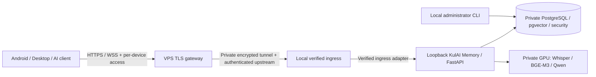

# Remote access architecture — implemented ingress TASK 4D.3B.1

The opt-in `kulai_memory.remote_ingress` package now implements a real loopback
TLS/mTLS listener with HTTP and WSS, invoking the existing FastAPI application
directly in the same process. It requires managed SECURE security, canonical head
`kulai_memory_0004` and security head `kulai_security_0003`. Default local transport
and LOCAL_DEV/ADB reverse remain unchanged. No public listener, VPS, Nginx,
WireGuard, DNS, firewall or main migration is installed. Sections describing those
components remain deployment requirements, not evidence of implementation.

## Implemented boundary and local verification

Uvicorn 0.54.0 supplies the H11 and WebSockets SansIO parsers. Small protocol
adapters read `transport.get_extra_info('ssl_object')` in `connection_made`, after
OpenSSL completes the handshake. The server SSLContext requires a client
certificate, a private CA and TLS 1.2/1.3. The adapter requires the configured
exact DNS SAN, valid certificate times and optionally a SHA-256 leaf pin; CN and
wildcards do not substitute for the SAN. Unknown peers are disconnected.
[Python transport SSL information](https://docs.python.org/3.14/library/asyncio-protocol.html#asyncio.BaseTransport.get_extra_info),
[Python certificate verification](https://docs.python.org/3.14/library/ssl.html#ssl.SSLContext.verify_mode).

An internal peer object is bound to that TLS transport and to one application
binding. The outer ASGI guard creates a per-request admission object bound to the
same scope, after Host/scheme/route/header and live read-only schema checks. The
AuthenticationMiddleware recognizes only that internal object, then runs its
original Authenticator/AuthorizationPolicy. Pairing and refresh retain their
exact capability contracts. No internal credential, HMAC header, proxy assertion
or second bearer system is introduced. There is no plaintext localhost hop.

Remote configuration is disabled by default. Enabled LOCAL_DEV, injected in-memory
auth sources, missing schema and mismatched heads refuse startup before listening.
Live schema/storage failures latch the remote boundary closed; restoring the DB
does not reopen the existing lifespan. An operator must stop and explicitly start
a fresh ingress process after verification. There is no autostart or automatic
recovery/re-pairing. A restored backup still requires separately approved credential
revocation before that manual restart; this task does not implement that recovery tool.

The public Host is compared with an explicitly configured HTTPS origin, independently
of the private ingress certificate hostname. All browser Origin, proxy/verified
headers, contradictory duplicates and non-allowlisted routes are denied. The public
origin must be a bare HTTPS origin without credentials, path, query or fragment.
Only the listed Memory/assistant/pairing/refresh and two WS contracts are exposed;
even `/health` is excluded. No requests are redirected or retried.

Limits: 64 KiB HTTP bodies (4 KiB capability bodies), 8 KiB/64 headers,
256 KiB binary WS messages, 16 KiB text messages and at most eight pending WS
messages. Uvicorn supplies socket backpressure; a queue overflow aborts the
connection. HTTP/body/idle/WS budgets are bounded (240/15/240/900 seconds by
default). The underlying asyncio TLS handshake is also bounded by its library
timeout. Original 600-second PCM byte limits and Voice Note v1 remain in force.
Private raw Uvicorn access/error diagnostics are disabled; application diagnostics
retain their existing fixed operation/status categories.

Run real, synthetic HTTPS/WSS tests using the backend interpreter:

```powershell
$env:KULAI_RUN_POSTGRES_INTEGRATION='1'
backend\.venv\Scripts\python.exe -m pytest backend/tests/test_remote_ingress.py backend/tests/integration/test_remote_ingress_tls.py backend/tests/integration/test_remote_ingress_lifecycle.py -q
```

Tests generate temporary CA/server/client certificates using test-only cryptography,
use real TCP/OpenSSL handshakes, and remove PKI after server shutdown. Security and
canonical writes use marker-owned PostgreSQL, real canonical repositories and
synthetic inference. The 19.2 MB audio case is an accelerated volume test, not a
ten-minute wall-clock endurance or physical Android/Internet/WireGuard test.

For an interactive synthetic listener:

```powershell
$env:KULAI_RUN_POSTGRES_INTEGRATION='1'
backend\.venv\Scripts\python.exe -m backend.tests.remote_ingress_fixture
```

The fixture prints temporary paths and a random loopback PORT, never credential
contents. Its private local `command.json` accepts `invite`, `pending`, `approve`
(exact session/device/full verification code) and `finish`. `result.json` may hold
a short-lived synthetic invitation. HTTPS clients load the printed CA and gateway
certificate/key, connect to `https://127.0.0.1:PORT`, and send `Host: memory.test`.
WSS clients connect with that same CA/client identity and Host. Finish/Ctrl+C closes
the listener and deletes the owned database and temporary PKI/control files.

`scripts/remote_ingress.py --enable --certificate <server.pem> --private-key
<server.key> --client-ca <gateway-ca.pem> --expected-gateway-identity <gateway-DNS-SAN>
--public-origin https://<configured-public-domain>` is a separate explicit backend
launcher, restricted to numeric loopback. It performs no DDL. Use only synthetic
configuration for this task; main currently requires separately approved schema
installation. Installing `backend[remote]` selects the reviewed Uvicorn 0.54.0;
other protocol versions fail closed pending review.

Android is unchanged and never receives the gateway private key or test CA. A future
public Nginx TLS gateway will hold the mTLS client identity; release Android will
use ordinary HTTPS/WSS and its existing per-origin bearer/session credentials.
The existing factory defaults and `scripts/dev.py --security-mode LOCAL_DEV` remain
local and use the unchanged local Host/listener checks.

## 1. Architecture



The VPS can run a small gateway without GPU. Canonical data and inference remain
on the local computer. Each device has its own session and rotating secrets. No
shared client bearer, multi-user database isolation or public model API is proposed.

## 2. Trust boundaries

Internet requests, client IPs and all supplied proxy headers are untrusted. The VPS
terminates public TLS and applies admission/resource limits; the backend still
authenticates credentials and enforces approved actions. A compromised VPS can see
application traffic at TLS termination, including credentials and Memory; this is an
explicit trust boundary, not end-to-end encryption from phone to GPU.

The private tunnel authenticates peers cryptographically. Upstream ingress must
also authenticate the gateway, validate the effective origin and fail closed. Local
administrator CLI/database access has provisioning authority and is never an HTTP
admin endpoint. PostgreSQL administrators and a compromised Android OS remain
outside the bearer protocol's protection. Keystore storage does not prove device
attestation or prevent use of a stolen bearer while valid.

## 3. Domain and certificates

Choose one canonical origin, for example `https://memory.example.invalid` (placeholder,
not a configured domain). Use a publicly trusted, automatically renewed server
certificate with the exact hostname. Maintain expiry alarms and renewal drills.
Android release requires HTTPS, derives WSS from that origin and keeps normal
hostname/certificate verification. Changing scheme/host/port requires explicit
configuration and pairing; it must not silently transfer an existing credential.

Redirects must not forward pairing/refresh proofs. Do not log request Authorization,
request/response bodies or query strings. The current client refuses redirects and
secret-bearing URL configuration. No production key or real token belongs in docs.

## 4. Tunnel choice

| Option | Benefits | Operational boundary |
| --- | --- | --- |
| WireGuard | Small peer-key based encrypted UDP tunnel, explicit routes | Manage peer keys, NAT reachability, routing and key revocation yourself |
| Tailscale | WireGuard transport, NAT traversal and relay fallback | Additional control-plane dependency and metadata/ACL management |
| Restricted reverse SSH forward | Outbound connection from local PC can work behind NAT | Pin SSH host keys, restrict forwarding/account privileges, monitor reconnect and avoid accidental public bind |

Proposed first deployment: WireGuard with the local computer initiating its peer
connection, minimal AllowedIPs and no forwarding to PostgreSQL/model ports. A NAT
mapping may require bounded PersistentKeepalive; choose it based on measured NAT
behavior. [WireGuard protocol](https://www.wireguard.com/protocol/),
[WireGuard quick start](https://www.wireguard.com/quickstart/).

If UDP/NAT constraints make this impractical, evaluate Tailscale ACLs and its direct
versus relay behavior before selecting it. Relay transport remains encrypted but
adds a dependency/latency boundary. [Tailscale encryption](https://tailscale.com/docs/concepts/tailscale-encryption),
[connection types](https://tailscale.com/docs/reference/connection-types).
These alternatives are not installed here; the final choice requires 4D.3B evidence.

## 5. Host, Origin and proxy identity

An ingress policy must separately validate the TLS hostname, HTTP Host, expected
public origin, and cryptographically authenticated gateway identity. Unknown Host
must fail before forwarding. Native Android/Desktop clients omit browser Origin;
future browser clients need an explicit allowlist and CSRF/CORS assessment.

The default middleware still accepts only a loopback Host/listener with matching
ports. The implemented opt-in in-process ingress has a separate TLS-bound admission
branch; a header or IP cannot select it. Simply putting nginx in front of a LOCAL_DEV
listener remains unsafe and is not a deployment procedure.

## 6. Forwarded headers

The gateway must strip all client-supplied Forwarded/X-Forwarded-* fields and any
ingress attestation field, then generate a minimal consistent set. The backend may
consume these values only after independently authenticating ingress; malformed,
duplicated or inconsistent Host/proto data must fail closed. An IP allowlist alone
is insufficient. Keep Uvicorn proxy-header parsing disabled until the new verified
adapter supplies a well-defined trusted scope. Current requests with proxy headers
remain denied, including on loopback.

## 7. Authenticated upstream

Prefer mTLS from the VPS gateway to a private local ingress: a private CA, distinct
client/server certificates, exact SAN verification, certificate rotation and explicit
revocation. Configure verification in both directions; nginx upstream client keys
are gateway secrets with restricted storage. [NGINX upstream TLS verification](https://docs.nginx.com/nginx/admin-guide/security-controls/securing-http-traffic-upstream).

The implemented adapter exposes the verified peer from OpenSSL through an internal
ASGI capability in the same process, as described above. If a future deployment adds
a separate local TLS terminator/process, its transfer to ASGI needs a separately
reviewed authenticated channel; plain `X-Verified` plus loopback is unacceptable.
WireGuard alone does not make HTTP metadata trusted.

## 8. REST, WSS and streaming

Forward REST without response caching; pairing/refresh responses are `no-store`.
Do not buffer streaming audio into an unbounded request, and preserve WebSocket
upgrade semantics/backpressure/cancellation. Nginx requires explicit handling of
Upgrade/Connection and appropriate idle timeouts. [NGINX WebSocket proxying](https://nginx.org/en/docs/http/websocket.html).

Separate connect timeout, DB/auth timeout, idle WS timeout and allowed audio-session
duration. Test long NOTE/ASK recordings, inference latency and transport cancellation
under the actual gateway; keep Voice Note v1 unchanged. Establish bounded frame/body
sizes and maximum simultaneous sessions. Backend currently reauthorizes each WS
frame with one coherent security SELECT plus read-only transaction setup; no
authorization cache delays revocation. Measure over the private tunnel before
considering a bounded cache with a documented revocation deadline.

Rotation revokes the predecessor access. Existing WS sessions using it close on
their next frame and clients must reconnect with the published replacement. Do not
replay a NOTE or writing operation to reconnect. Preserve ingestion IDs/idempotency.
Android defers proactive renewal during active voice only while access remains valid;
test that boundary under the gateway. Expiry/revocation still ends the predecessor's
access and never authorizes write replay.

## 9. Firewall, limits and diagnostics

The future public surface is TLS gateway traffic only; tunnel administration and
gateway SSH require separately limited access. Local firewall rules should permit
only the selected private ingress path. PostgreSQL, Ollama/Whisper/BGE and ordinary
backend listeners must stay private. No such firewall changes are made by this task.

Use ingress body/frame/concurrency limits and separate pairing/refresh abuse controls,
with per-device limits only after authentication. The current durable global 120/min
security capability limiter is an application safety bound, not a public DDoS defense.
Monitor status categories, bounded timing/count metrics, pool exhaustion and tunnel
health. Redact proofs/tokens, private text/audio, complete URLs and SQL parameters in
every component, including gateway diagnostics and tracing. Monitoring must not
become a route around Memory authorization.

## 10. Local computer unavailable

The gateway returns a fixed unavailable response/503 without private config and
without queuing writes. Android locks private functions when access/renewal cannot
be verified, uses bounded reconnect backoff, and never falls back to LOCAL_DEV.
Access is at most one hour, refresh 30 days and absolute session 90 days. Connectivity
returning within the remaining refresh/absolute lifetime can resume a session; longer
outages require pairing. An ambiguous refresh response requires pairing even when
the server later returns. Do not automatically retry a possibly applied refresh or
a Memory write. No offline outbox is implemented here.

## 11. VPS/tunnel recovery

Keep reproducible gateway configuration and separately protected TLS/tunnel keys.
Test restarting gateway/tunnel/local PC independently. Restore the same verified
public origin; a different origin requires deliberate reconfiguration/pairing. On
gateway/key compromise rotate ingress/tunnel secrets, review client credentials,
revoke affected devices/sessions and investigate redacted audit events before
reopening traffic. A failed gateway upgrade must fail closed; a rollback cannot
restore an expired/revoked credential through cached authorization.

## 12. PostgreSQL backup and session recovery

Security v3 snapshots include all session fields and refresh digests/consumption
history in addition to devices, access tokens, pairing and rate state. Verified
backup requires actual pg_restore to an owned temporary DB and complete canonical
and security fingerprint equality. Canonical-only and v1/v2 archives remain valid
historical forms with explicit absence, not fabricated session records.

Restoring a past DB can rewind rotation/revocation and re-enable a stolen old secret.
Before serving a recovered database: keep ingress closed; verify archive and restore;
run strict doctor; review restore time; **revoke all restored active sessions and
associated access credentials (and legacy access credentials affected by rewind)**
using a separately approved, transactional administration procedure. Restore must
not silently resume phone login. Require pairing again, then reopen only after
synthetic expiry/replay/revoke checks. This recovery revocation procedure is a
required 4D.3B operational deliverable; 4D.3A never executes it on main.

Security upgrade on main also remains separately authorized: stop all writers/admin
commands -> strict doctor -> full backup -> actual restore verification -> archive
and source revalidation -> guarded additive upgrade -> doctor/full fingerprints.
Canonical head stays `kulai_memory_0004`; security head becomes `kulai_security_0003`.
Existing v1/v2 row fingerprints must match; new tables start empty. No startup DDL,
destructive downgrade or automatic production migration is supported.

## 13. TASK 4D.3B steps and acceptance gates

1. Review 4D.3A code/test results and approve separately any main schema installation.
2. Choose VPS/domain and tunnel after measuring NAT/UDP constraints; threat-model the
   trust in TLS termination, key storage, gateway compromise and recovery.
3. Implement/test verified mTLS ingress and Host/Origin/Forwarded policy on isolated
   loopback test servers; prove spoofed headers/certificates cannot bypass auth.
4. Prepare reviewable gateway/tunnel/firewall/DNS/certificate configurations and
   secret provisioning instructions; obtain deployment authorization before applying.
5. Add gateway rate/frame/concurrency limits, TLS renewal alarms, bounded monitoring,
   private-only model/database listeners and tested deny-by-default routing.
6. Test REST and long WSS/audio, backpressure, cancellation, provider ownership,
   rotation during a voice session, outages and reconnect without write replay.
7. Implement/test the approved backup-recovery credential revocation procedure and
   perform a full synthetic backup/restore/tunnel/VPS recovery drill.
8. Only then deploy the authorized gateway/tunnel, run remote physical Android
   NOTE/ASK/MEMORY/TTS against separately approved data/providers, and verify main
   fingerprints, redaction and revocation. Do not treat synthetic smoke as real RAG.
9. Document rollback/recovery and credential/key rotation; Desktop/AI clients may
   adopt the same per-device protocol in separate client work. MCP, accounts, QR,
   discovery and Memory Intelligence remain separate tasks.
